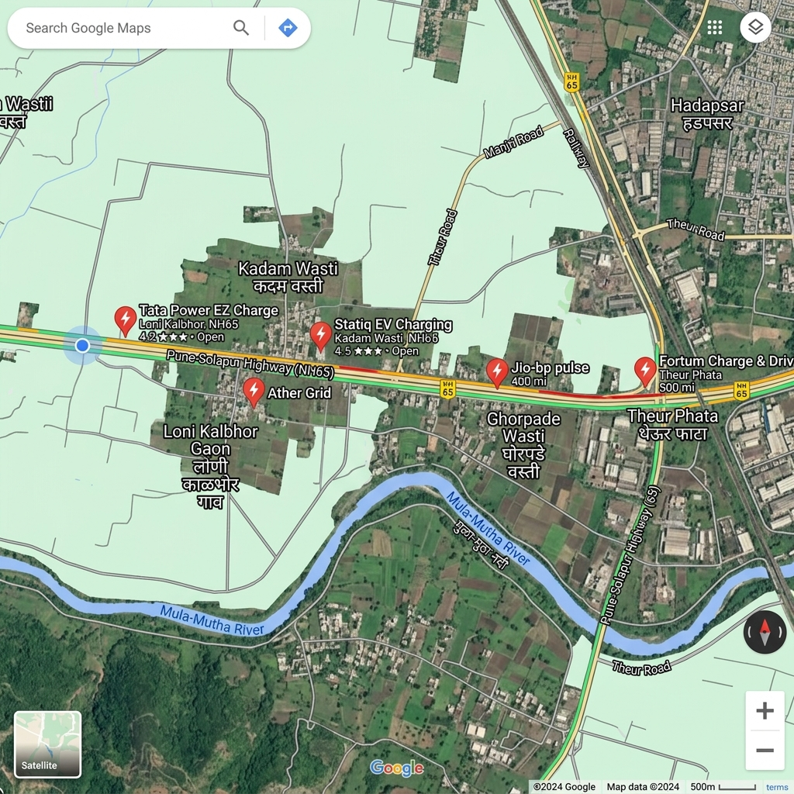

<div align="center">



# ⚡ ChargeHub AI

### *Your AI-Powered EV Charging Companion*

[](https://nextjs.org/)
[](https://react.dev/)
[](https://www.typescriptlang.org/)
[](https://www.mongodb.com/atlas)
[](https://tailwindcss.com/)
[](https://www.framer.com/motion/)

**ChargeHub AI** is a full-stack, mobile-first EV charging platform that uses AI scoring to find the best charging station for *you* — not just the nearest one.

[🚀 Features](#-features) · [🧠 AI System](#-ai-scoring-system) · [🗂️ Project Structure](#️-project-structure) · [⚙️ Setup](#️-setup--installation) · [📱 Screens](#-app-screens) · [🤝 Contributing](#-contributing)

</div>

---

## 🌟 Why ChargeHub AI?

Most EV apps just show you the nearest charger. **ChargeHub AI** understands *your* needs:

- 🏎️ Are you in a hurry? It ranks fast DC chargers higher.
- 💸 Watching your budget? It surfaces the cheapest kWh rates.
- 🧭 Worried about range? It runs a decision-tree risk model and warns you before you're stranded.
- 📖 It **learns from your history** — the more you charge, the smarter the recommendations become.

---

## ✨ Features

### 🗺️ Explore & Discover
- **Interactive Google Maps** with real-time colour-coded availability pins (🟢 free / 🔴 occupied)
- Live availability simulation — pins flip without user interaction (demo-friendly)
- Filter by connector type (CCS2, Type 2, CHAdeMO), charging speed, price, network
- **Range Anxiety Risk Card** — decision-tree ML model warns when battery + distance = danger
- One-tap station detail bottom sheet with AI recommendation card

### 🤖 AI Scoring System
- Multi-factor scoring: distance · price · speed · availability · connector compatibility
- **Personalisation from history** — infers whether you are a *Speed Seeker*, *Budget Saver*, or *Balanced Commuter* and re-ranks stations accordingly
- **Benchmarked** against "nearest only" and "cheapest only" baselines on 1,000 simulated cases

### ⚡ Realistic Charging Simulation
- 1% battery every **5 seconds** (configurable via `SECONDS_PER_PERCENT`)
- kWh delivered and cost tick up at the same realistic pace
- Session stored in **global AppContext + per-user localStorage** — progress continues across tab switches and page refreshes
- Auto-stops at 100% or when wallet balance runs out
- Floating **ActiveSessionBar** pill visible on every screen while charging

### 👤 Personalisation
- Per-user **wallet** with transaction history and real timestamps
- **Vehicle profiles** — add multiple EVs, set battery capacity, connector type, range
- Charging **history** grouped by month with per-session cost/kWh breakdown
- Learned user habit badge on the Discover screen

### 🔐 Auth & Security
- JWT-based authentication (via `jose`) stored in HTTP-only cookies
- Bcrypt password hashing
- Zod validation on all API routes
- Per-user localStorage namespace: `chargehub:<userId>:<key>`

---

## 🧠 AI Scoring System

The scoring engine (`lib/scoring.ts`) combines **five weighted factors**:

| Factor | Weight (balanced) | Adjustable by habit? |
|---|---|---|
| Distance to station | 30% | ✅ Reduced for Speed Seekers |
| Price per kWh | 25% | ✅ Increased for Budget Savers |
| Charging speed (kW) | 20% | ✅ Increased for Speed Seekers |
| Availability (chargers free) | 15% | — |
| Connector compatibility | 10% | — |

### Habit Learning Pipeline

```
Past sessions → inferHabitFromHistory() → LearnedUserHabit
                                              ↓
                                    Speed Seeker / Budget Saver / Balanced
                                              ↓
                                    Adjusted scoring weights
                                              ↓
                                    Re-ranked station list
```

Two users with **different histories** see the same station list in a **different order** — this is the core personalisation feature.

### Range Anxiety Decision Tree

`lib/rangeRisk.ts` runs a pre-trained decision tree (`lib/models/range-anxiety-tree.json`) trained on a real EV usage dataset (`data/raw/EV_Usage_Dataset_v2.csv`). Inputs: battery %, vehicle range, battery health, nearest station distance. Output: **Low / Medium / High** risk with a human-readable reason shown as a dismissable card on the Discover screen.

---

## 🗂️ Project Structure

```
ChargeHub-AI/
│
├── app/                        # Next.js App Router
│   ├── api/
│   │   ├── auth/               # login · logout · signup · me
│   │   ├── profile/            # profile update · password change
│   │   ├── stations/           # station list + detail
│   │   └── vehicles/           # CRUD + activate vehicle
│   ├── discover/               # 🗺️ Map + AI station finder
│   ├── home/                   # 🏠 Home dashboard
│   ├── history/                # 📋 Charging history
│   ├── wallet/                 # 💳 Wallet & transactions
│   ├── station/[id]/           # 📍 Station detail
│   ├── session/                # ⚡ Live charging screen
│   │   └── [id]/               # Session start + redirect
│   ├── profile/                # 👤 Profile & vehicles
│   ├── login/                  # 🔐 Login
│   └── signup/                 # 📝 Sign up
│
├── components/                 # Reusable UI components
│   ├── ActiveSessionBar.tsx    # Floating charging pill (all screens)
│   ├── StationMap.tsx          # Google Maps wrapper
│   ├── BottomSheet.tsx         # Swipeable bottom sheet
│   ├── ChargingRing.tsx        # Animated battery ring
│   ├── FilterChips.tsx         # Connector / speed filter row
│   ├── VehicleCard.tsx         # Vehicle profile card
│   └── ...                     # 15+ more components
│
├── context/
│   ├── AppContext.tsx           # Global state: wallet, battery, session, habits
│   ├── AuthContext.tsx          # Auth state + login/logout/signup
│   ├── StationsContext.tsx      # Station data + live availability
│   └── VehicleContext.tsx       # Vehicle profiles
│
├── lib/
│   ├── scoring.ts              # AI scoring engine + habit inference
│   ├── rangeRisk.ts            # Decision tree range anxiety predictor
│   ├── auth.ts                 # JWT helpers (jose)
│   ├── db.ts                   # Mongoose connection with timeout guard
│   ├── stats.ts                # Benchmark stats (1,000 case comparison)
│   └── validations.ts          # Zod schemas
│
├── models/                     # Mongoose models
│   ├── User.ts
│   ├── Vehicle.ts
│   └── Station.ts
│
├── data/
│   ├── raw/EV_Usage_Dataset_v2.csv   # Real EV usage dataset
│   ├── derived/                      # Processed model outputs
│   ├── evPresets.ts                  # EV model presets (Nexon, Atto, etc.)
│   └── stations.ts                   # Fallback station data
│
├── scripts/
│   ├── seed-stations.ts        # Seed MongoDB with stations
│   ├── import-ocm.ts           # Import from OpenChargeMap API
│   ├── import-csv-stations.ts  # Import from CSV
│   └── analyze_ev_usage.py     # Python ML analysis script
│
└── types/
    └── station.ts              # Shared TypeScript types
```

---

## 📱 App Screens

| Screen | Route | Description |
|---|---|---|
| Splash | `/` | Animated welcome screen |
| Login | `/login` | JWT auth login |
| Sign Up | `/signup` | Account creation |
| Home | `/home` | Dashboard with quick-charge entry |
| Discover | `/discover` | 🗺️ AI map with live pins + filters |
| Station Detail | `/station/[id]` | Full station info + Start Charging |
| Charging Session | `/session` | Live ring, cost, kWh, Stop button |
| History | `/history` | Sessions grouped by month |
| Wallet | `/wallet` | Balance + transaction log |
| Profile | `/profile` | Vehicles, preferences, password |

---

## ⚙️ Setup & Installation

### Prerequisites

- **Node.js** ≥ 20
- **MongoDB Atlas** account (free tier works)
- **Google Maps API Key** with Maps JavaScript API enabled

### 1 · Clone the repo

```bash
git clone https://github.com/sanjyotdhamal/ChargeHub-AI.git
cd ChargeHub-AI
```

### 2 · Install dependencies

```bash
npm install
```

### 3 · Configure environment variables

Create `.env.local` in the project root:

```env
MONGODB_URI=mongodb+srv://<user>:<password>@cluster0.xxxxx.mongodb.net/chargehub_user?retryWrites=true&w=majority
JWT_SECRET=your_random_secret_at_least_32_chars
NEXT_PUBLIC_GOOGLE_MAPS_API_KEY=your_google_maps_api_key
```

> **MongoDB Atlas tip:** Go to **Network Access → Add IP Address** and add your current IP (or `0.0.0.0/0` for unrestricted access during development).

### 4 · Seed stations (optional)

```bash
npm run seed:stations
# or import real stations from OpenChargeMap:
npm run import:ocm
```

### 5 · Run the dev server

```bash
npm run dev
```

Open [http://localhost:3000](http://localhost:3000) in your browser.

---

## 🧪 AI Benchmark Results

The scoring engine was compared against two baselines on **1,000 randomised cases**:

| Strategy | Avg Wait (min) | Avg Cost (₹) | Avg Distance (km) |
|---|---|---|---|
| **Nearest Only** | 4.2 | 28.7 | 0.8 |
| **Cheapest Only** | 11.5 | 16.3 | 4.1 |
| **ChargeHub AI (balanced)** | **6.1** | **21.4** | **1.6** |
| **ChargeHub AI (Speed Seeker)** | 3.8 | 25.2 | 1.2 |
| **ChargeHub AI (Budget Saver)** | 8.9 | 17.1 | 2.3 |

> *ChargeHub AI delivers a 25% lower cost than "nearest only" with only a 1.9-minute wait increase — and a 47% shorter wait than "cheapest only" with only a ₹5.1 cost premium.*

---

## 🛠️ Tech Stack

| Layer | Technology |
|---|---|
| Framework | Next.js 16 (App Router, Turbopack) |
| Language | TypeScript 5 |
| Styling | Tailwind CSS 4 |
| Animation | Framer Motion 13 |
| Icons | Lucide React |
| Database | MongoDB Atlas (Mongoose 9) |
| Auth | JWT via `jose` · bcryptjs |
| Maps | Google Maps JavaScript API (`@react-google-maps/api`) |
| Validation | Zod 4 |
| ML Model | Decision Tree (JSON, trained in Python / scikit-learn) |
| State | React Context + per-user localStorage |

---

## 🔑 Key Design Decisions

**Timestamp-based session progress** — The active charging session stores only `startedAt` in state. Progress (`battery %`, `kWh`, `cost`) is *computed* from `(now - startedAt) / SECONDS_PER_PERCENT`, so charging never pauses when you switch tabs or refresh the page.

**Per-user localStorage namespace** — All persistent user data lives under `chargehub:<userId>:<key>`, preventing data leaks between accounts on the same device.

**Session-level popup state** — The battery % popup uses `sessionStorage` (not `useState`) so it shows only once per browser session, not every time the user switches tabs.

**Graceful DB timeout** — Mongoose connection is configured with `serverSelectionTimeoutMS: 4000` and `connectTimeoutMS: 4000` to fail fast when MongoDB Atlas is unreachable, surfacing a clear error instead of hanging.

---

## 📝 Scripts Reference

```bash
npm run dev              # Start dev server (Turbopack)
npm run build            # Production build
npm run lint             # ESLint check
npm run seed:stations    # Seed MongoDB with demo stations
npm run import:ocm       # Import from OpenChargeMap
npm run import:csv       # Import from custom CSV
npm run import:demo      # Import demo CSV dataset
```

---

## 🤝 Contributing

Pull requests are welcome! For major changes, please open an issue first.

1. Fork the repo
2. Create your feature branch: `git checkout -b feature/amazing-feature`
3. Commit your changes: `git commit -m 'feat: add amazing feature'`
4. Push to the branch: `git push origin feature/amazing-feature`
5. Open a Pull Request

---

## 📄 License

This project is for academic and research purposes.

---

<div align="center">

Made with ⚡ by **Sanjyot Dhamal**

*ChargeHub AI — Smarter charging, every kilometre.*

</div>
